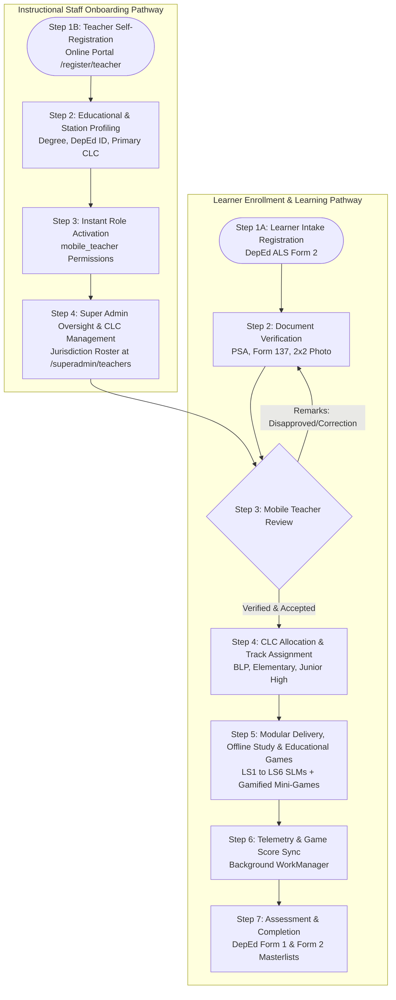
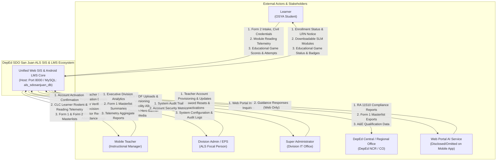
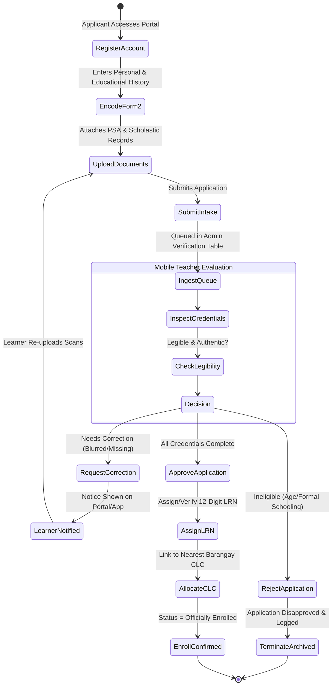
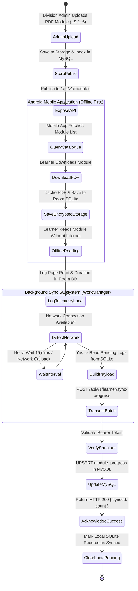
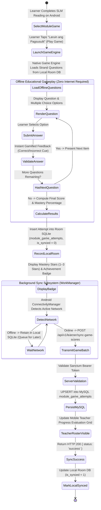
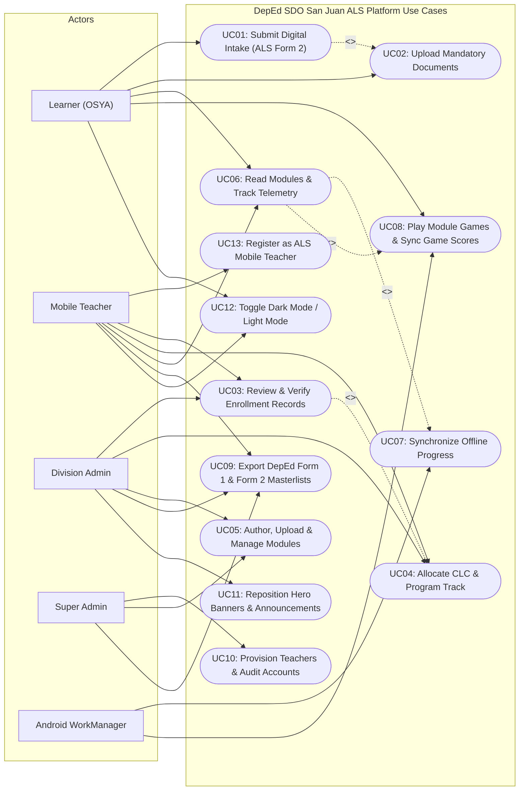
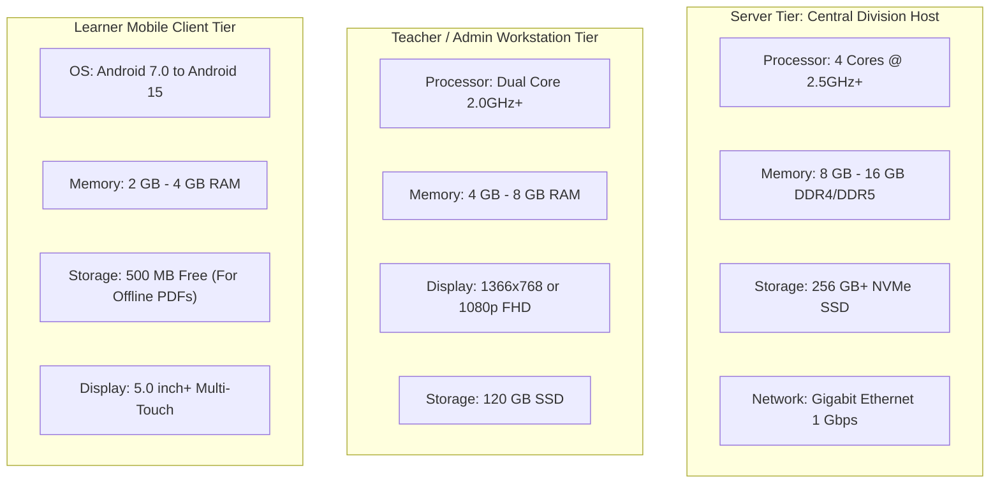
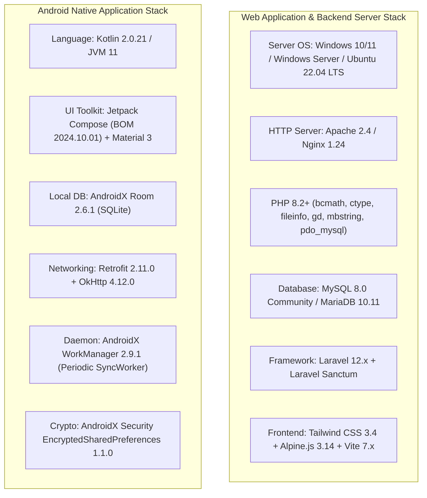
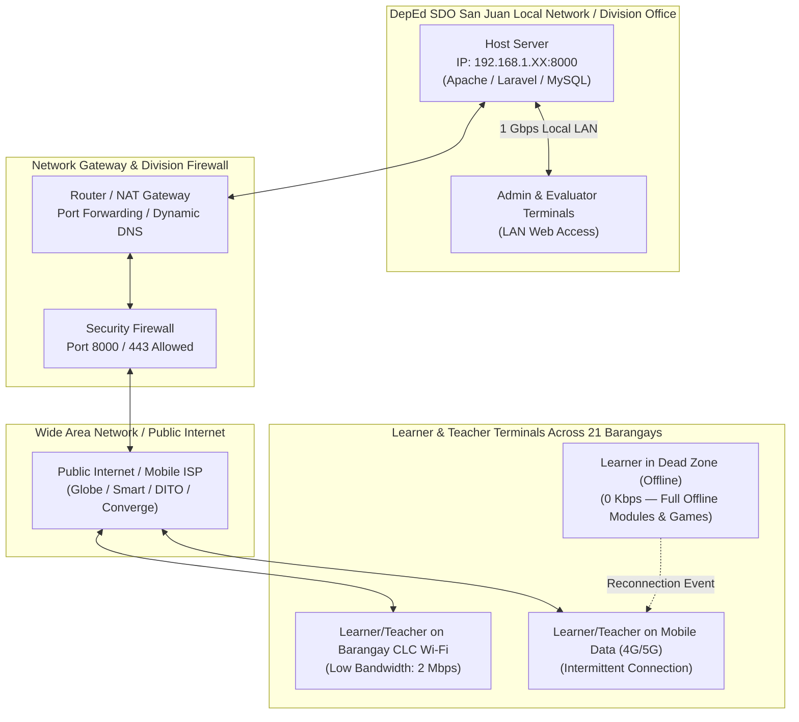

# DepEd SDO San Juan — Alternative Learning System (ALS)
## System Documentation & Technical Appendices (A–G)
**Project Title:** Web-Based Student Information System (SIS) & Android-Based Modular Learning Management System (LMS)  
**Governing Agency:** Department of Education (DepEd) — Schools Division Office (SDO) of San Juan City  
**Compliance Standard:** Republic Act No. 11510 (Alternative Learning System Act) & DepEd Order No. 27, s. 2017  
**System Version:** SIS Web v2.1 / Android LMS v2.1 (Release Alpha)

---

## 📑 Table of Contents
1. [Appendix A. Procedure of the System](#appendix-a-procedure-of-the-system)
2. [Appendix B. Context Diagram](#appendix-b-context-diagram)
3. [Appendix C. Activity Diagram](#appendix-c-activity-diagram)
4. [Appendix D. Use Case Diagram](#appendix-d-use-case-diagram)
5. [Appendix E. Hardware Requirements](#appendix-e-hardware-requirements)
6. [Appendix F. Software Requirements](#appendix-f-software-requirements)
7. [Appendix G. Network Requirements](#appendix-g-network-requirements)

---

## Appendix A. Procedure of the System

The DepEd SDO San Juan Alternative Learning System (ALS) platform is a unified dual-platform solution composed of a centralized Web SIS/LMS and an offline-first Android Mobile LMS. The operational procedures govern the complete life cycle of Out-of-School Youth and Adults (OSYA) and ALS Mobile Teachers from registration to assessment and graduation.



### 1. Registration Procedures

#### Procedure 1.A: Learner Intake & Enrollment Procedure (DepEd ALS Form 2)
1. **Intake Access:** The applicant or walk-in registrar accesses the Web Portal (`/register`) or Mobile Intake Terminal.
2. **LRN Check & Personal Profiling:**
   - If the applicant has an existing 12-digit Learner Reference Number (LRN) from formal basic education, the system validates the format and links prior history.
   - If the applicant is a first-time learner with no prior LRN, the applicant is flagged as *Intake Pending / LRN to be Generated*.
3. **Data Encoding:** The applicant completes standard DepEd ALS Form 2 fields (Birth details, Mother's Maiden Name, Address within San Juan's 21 barangays, Educational Attainment, Employment Status, Special Needs, and Preferred Learning Modality).
4. **Program Track Placement:** The system validates age and prior schooling to place the applicant in the appropriate track:
   - **Basic Literacy Program (BLP):** Non-literate youth and adults (Reading, Writing, Numeracy).
   - **Accreditation and Equivalency (A&E) Elementary:** Completers of BLP or formal Grades 1–5 dropouts aged 12 and above.
   - **Accreditation and Equivalency (A&E) Junior High School (Secondary):** Elementary completers or formal Grades 7–10 dropouts aged 16 and above.
5. **Document Upload:** The applicant uploads digital proof of birth (PSA/NSO Birth Certificate or Barangay Certificate) and prior scholastic records (Form 137, Report Card, or PEPT certificate).

#### Procedure 1.B: ALS Mobile Teacher Registration & Station Onboarding (`/register/teacher`)
1. **Teacher Registration Access:** An incoming instructional manager or mobile educator navigates to `/register/teacher` directly or switches via the registration role tab.
2. **Personal & Civil Profiling:** The teacher enters their Full Name (First Name, Middle Name, Last Name, Name Extension), Gender, Civil Status, Birthdate, and residential address in San Juan City.
3. **Educational & Station Assignment:**
   - Enters Highest Educational Attainment (e.g., Bachelor of Secondary Education [BSEd], Master of Arts in Education).
   - Selects primary Community Learning Center (CLC) (e.g., West Crame CLC, San Juan ES CLC, Batis CLC, etc.).
4. **Account Security:** The teacher configures their unique username, DepEd/personal email address, and an 8+ character password.
5. **Role Activation & Authentication:** The system generates a `mobile_teacher` user with `active` status, links the selected CLC, and immediately logs the educator in to the Administrative Management Dashboard (`/admin/dashboard`).
6. **Super Administrator Governance:** The Super Admin monitors all registered educators via `/superadmin/teachers` to reassign CLCs, reset credentials, or deactivate accounts when needed.

#### Procedure 1.C: Portal Sign-In & Unified Email-Based Authentication (`/login`)
1. **Authentication Mode:** Users across all administrative and learner roles sign in using their **registered Email Address** and secure password. The backend authentication pipeline (`AuthController::login`) performs email-first matching with automatic lowercase normalization, whitespace trimming, and legacy username fallback.
2. **Standard Verified Demo Credentials:**

| Role / Track | Registered Email Address | Username / LRN | Password | Assigned Track / Station |
| :--- | :--- | :--- | :--- | :--- |
| **Super Administrator** | `superadmin.als@deped.gov.ph` | `superadmin_als` | `Password123!` | Division IT / All CLCs |
| **Division Administrator** | `admin.als@deped.gov.ph` | `admin_als` | `Password123!` | SDO San Juan Division Office |
| **Mobile Teacher** | `juan.delacruz@deped.gov.ph` | `teacher_juan` | `Password123!` | West Crame Community Learning Center |
| **Mobile Teacher** | `alyssa.reyes@deped.gov.ph` | `teacher_alyssa` | `Password123!` | Batis Community Learning Center |
| **Learner (BLP)** | `learner.blp@deped.gov.ph` | `learner_blp`<br>*(LRN: `136542240010`)* | `Password123!` | Basic Literacy Program (BLP) |
| **Learner (Elementary)** | `learner.elem@deped.gov.ph` | `learner_elem`<br>*(LRN: `136542240020`)* | `Password123!` | A&E Elementary (Grades 1–6) |
| **Learner (Junior High)** | `learner.jhs@deped.gov.ph` | `learner_jhs`<br>*(LRN: `136542240030`)* | `Password123!` | A&E Junior High School (Secondary) |
| **Learner (General)** | `mark.bautista@example.com` | `learner_mark`<br>*(LRN: `136542240001`)* | `Password123!` | A&E Junior High School |

3. **Quick Demo Access Helpers:** The login interface provides one-click credentials auto-fill buttons categorized by Learner Track (BLP, Elementary, JHS) and Staff Role for streamlined evaluation and demonstration.
4. **Session Management:** Web portal issues secure HTTP-only session cookies; Android LMS utilizes Laravel Sanctum personal access bearer tokens.

---

### 2. Enrollment Verification & Teacher Review Procedure
1. **Intake Queue Ingestion:** Submissions populate the Division Intake Queue (`/admin/enrollments`) prioritized by submission timestamp and CLC district.
2. **Document Inspection:** The assigned ALS Mobile Teacher or Division Evaluator inspects civil and academic documents.
3. **Action Execution:**
   - **Approved:** The enrollment transitions to `Enrolled`. If an LRN was pending, an official DepEd LRN is recorded.
   - **Needs Correction:** Evaluator inputs official remarks (e.g., *"PSA copy blurred; please upload clear scanned page"*). The learner dashboard and mobile app display a corrective alert allowing immediate re-upload.
   - **Disapproved / Rejected:** Formally rejected under DepEd A&E guidelines (e.g., under minimum age, currently enrolled in formal schooling). Audit remarks are logged permanently.

---

### 3. Community Learning Center (CLC) Allocation Procedure
1. **Geographic Mapping:** Learners are allocated to one of the 12 accredited Community Learning Centers (CLCs) across San Juan City (e.g., West Crame CLC, San Juan Elementary School CLC, Batis CLC, Kabayanan CLC, Addition Hills CLC).
2. **Teacher Assignment:** Mobile Teachers are linked to their respective CLC rosters.
3. **Capacity & Delivery Mode:** The division administrator balances classroom seats and designates face-to-face, modular distance, or digital learning modalities.

---

### 4. Self-Learning Module (SLM) Distribution & Publishing Procedure
1. **Module Repository Access:** Administrators and Mobile Teachers access the centralized repository (`/admin/modules`).
2. **Uploading DepEd SLMs:**
   - Files are uploaded in standard PDF format (up to 25 MB) corresponding to Learning Strands 1 through 6.
   - Metadata is indexed: Strand Code, Target Level, Sub-Level (e.g., Grades 7–10), Language (English/Filipino), and Version.
3. **Publication Control:**
   - **Publish:** Module is immediately exposed across Web and Mobile REST APIs (`/api/v1/modules`).
   - **Unpublish / Draft:** Retains historical learner records while hiding the module from the active student catalog.
   - **In-Place Revision (Edit):** Admins and teachers can edit metadata and replace the underlying PDF file without severing historical progress IDs.

---

### 5. Modular Learning, Gamified Educational Games & Offline Telemetry Sync Procedure
1. **Web Study:** Learners can open any module directly in the browser using the integrated fit-page/fit-width PDF viewer with Dark, Light, and Sepia reading themes.
2. **Mobile Offline Download:**
   - On Android devices, learners download official DepEd Self-Learning Modules (LS1–LS6) over Wi-Fi or mobile data into encrypted local app storage.
   - The learner reads modules offline without an active internet connection.
3. **Module-Linked Gamified Learning (Educational Mini-Games):**
   - Each module is linked with interactive comprehension games and assessment quizzes designed to test mastery of learning competencies.
   - **Offline Playability:** Learners play games completely offline without requiring mobile data.
   - **Attempt Persistence:** Local SQLite (Room DB) records each game attempt (`score`, `max_score`, `time_spent_seconds`, `is_passed`, `completed_at`).
4. **App AI Disclosure Notice:**
   - The AI virtual assistant feature has been **officially disclosed / decommissioned from the mobile application**. The Android app is engineered exclusively for **Modular Study** and **Gamified Educational Games**, ensuring zero battery drain, zero unexpected data charges, and zero distraction during self-paced study.
5. **Background Synchronization:**
   - Android `WorkManager` triggers a periodic background sync worker (`SyncWorker`) every 15 minutes, or immediately upon network reconnect.
   - Two distinct payloads are synced:
     - Reading Telemetry: `POST /api/v1/learner/sync-progress`
     - Educational Game Scores: `POST /api/v1/learner/sync-game-scores`
   - Both payloads update the centralized MySQL database with bearer token authentication, making progress visible to Mobile Teachers.

---

### 6. Assessment & DepEd Formal Reporting Procedure
1. **Progress Verification:** Mobile Teachers view synchronized reading hours and module completion tallies per learner.
2. **DepEd Form 1 Masterlist Generation:**
   - The system formats official **DepEd ALS Form 1 (Individual Learning Profile & Masterlist)** compliant with Republic Act 11510.
   - Filterable by Calendar Year, Community Learning Center (CLC), and Program Track with printable PDF/print layouts.
3. **DepEd Form 2 Intake Sheet Export:** Individual verified Form 2 documents are archived for division submission.
4. **Graduation & Equivalency Clearance:** Completers are cleared for the official DepEd A&E Certification Exam.

---

## Appendix B. Context Diagram

The Context Diagram (Data Flow Diagram Level 0) defines the system boundary of the **DepEd SDO San Juan ALS Platform** and illustrates all external entities interacting with the central system.



### Context Data Flow Specification Table

| External Entity | Input Data Flow (To System) | Output Data Flow (From System) |
| :--- | :--- | :--- |
| **Learner (OSYA)** | Digital Intake details (DepEd Form 2), PSA/Birth certificate scans, Form 137 scholastic cards, reading position telemetry (`last_page_read`), module completion markers, interactive game quiz attempts and scores. | Real-time intake status, official LRN confirmation, downloadable PDF modules (LS1–LS6), interactive PDF reader, module educational mini-games and mastery badges. |
| **ALS Mobile Teacher** | **Teacher Self-Registration Application (Credentials, Degree, CLC selection)**, document verification verdicts (Approved/Correction/Disapproved), evaluator remarks, attendance inputs, learner portfolio assessments. | **Account activation confirmation**, CLC-assigned learner roster, individual reading logs, game attempt scores, offline sync timestamps, printable DepEd Form 1 & Form 2 sheets. |
| **Division Administrator** | Official DepEd SLM modules (PDFs), strand categorization, CLC configurations, division announcement banners and carousel photo coordinates. | Executive division dashboard metrics (Active enrollments, track distribution, module downloads), division-wide Form 1 consolidations. |
| **Super Administrator** | Teacher account creation, CLC jurisdiction assignments, role elevations, emergency password resets. | System security audit trail, active user roster, background worker status logs. |
| **DepEd Central / NCR** | Official ALS K-to-12 Curriculum guidelines, standard module releases, A&E testing schedules. | DepEd Form 1 Masterlist exports, division enrollment tallies, RA 11510 compliant audit records. |
| **Web Portal AI Assistant** | System guardrails, ALS knowledge prompts, web portal public inquiries. *(Officially disclosed/decommissioned on mobile app).* | Safe, accurate, division-bounded educational assistance in Filipino and English on the web portal. |

---

## Appendix C. Activity Diagram

The following Activity Diagrams specify the step-by-step logic and decision paths across key critical subsystems.

### Activity Diagram 1: Learner Digital Intake & Document Verification Workflow



---

### Activity Diagram 2: ALS Mobile Teacher Registration & Station Onboarding Workflow

```mermaid
stateDiagram-v2
    [*] --> NavigateTeacherRegister: Educator Visits /register/teacher
    NavigateTeacherRegister --> FillTeacherDetails: Enters Name, Contact, & Address
    FillTeacherDetails --> SelectDegreeAndCLC: Chooses Educational Degree & CLC
    SelectDegreeAndCLC --> DefineCredentials: Sets Username, Email, & Password
    DefineCredentials --> ValidateInput: System Validates Form (Unique Email/User)
    
    ValidateInput --> InputInvalid: Validation Errors (Duplicate/Weak Password)
    InputInvalid --> FillTeacherDetails: Display Actionable Error Prompts

    ValidateInput --> InputValid: Validation Passed
    InputValid --> CreateTeacherAccount: Insert into users (role: mobile_teacher, status: active)
    CreateTeacherAccount --> CreateTeacherProfile: Insert into user_profiles
    CreateTeacherProfile --> LinkCLC: Associate CLC (assigned_teacher_id)
    LinkCLC --> AutoLogin: Authenticate Session (Auth::login)
    AutoLogin --> RedirectDashboard: Redirect to /admin/dashboard
    RedirectDashboard --> [*]
```

---

### Activity Diagram 3: Self-Learning Module Offline Caching & Telemetry Sync



---

### Activity Diagram 4: Interactive Module Educational Games & Score Synchronization Workflow



---

## Appendix D. Use Case Diagram

The Use Case Diagram defines the interactions between the system's human and system actors and the operational capabilities of the platform.



### Detailed Use Case Specifications

#### UC01: Submit Digital Intake (DepEd ALS Form 2)
* **Primary Actor:** Learner (OSYA Applicant)
* **Preconditions:** Applicant has accessed the portal via web or registration kiosk.
* **Main Flow:**
  1. Applicant selects target academic track (BLP, Elementary, Junior High).
  2. Applicant encodes birth details, address in San Juan City, parent information, and prior schooling.
  3. Applicant enters existing LRN or requests new intake assignment.
  4. System validates required fields and stores intake draft in `enrollments` table.
* **Postconditions:** Enrollment record created with status `Pending`; tracking reference generated.

#### UC03: Review & Verify Enrollment Records
* **Primary Actor:** Mobile Teacher / Division Administrator
* **Preconditions:** Submissions exist in the verification queue.
* **Main Flow:**
  1. Evaluator filters enrollments by CLC and submission date.
  2. Evaluator opens individual record and inspects scanned birth and scholastic certificates.
  3. Evaluator selects: **Approve** (assigns CLC and LRN), **Needs Correction** (enters actionable remarks), or **Reject** (inputs rejection justification).
  4. System updates database and fires status change notices.
* **Postconditions:** Enrollment state updated; applicant permissions updated across web and mobile.

#### UC05: Author, Upload & Manage Modules (SLMs)
* **Primary Actor:** Division Administrator / Super Administrator
* **Preconditions:** Official DepEd ALS module PDF is available.
* **Main Flow:**
  1. Actor accesses `/admin/modules`.
  2. Actor selects Learning Strand (LS1 to LS6), Program Level, Language Track, and Version.
  3. Actor selects PDF file (up to 25 MB) and clicks **Upload & Save Module**.
  4. Actor can toggle **Publish/Unpublish** or click **Edit** to replace the PDF file.
* **Postconditions:** Module stored in `storage/app/public/modules`, indexed in `modules` table, and served via `/api/v1/modules`.

#### UC07: Synchronize Offline Progress
* **Primary Actor:** System Daemon (Android WorkManager `SyncWorker`) / Learner
* **Preconditions:** Learner has completed reading sessions offline in the Android app.
* **Main Flow:**
  1. `SyncWorker` executes periodically (every 15 minutes) or on network reconnection.
  2. `SyncWorker` reads pending telemetry entries from Room SQLite database (`CachedTelemetryEntity`).
  3. Encrypts payload with Bearer token and sends HTTP POST to `/api/v1/learner/sync-progress`.
  4. Server writes records to MySQL `learner_module_progress` and updates learner dashboard aggregates.
  5. App receives HTTP 200 and marks local records as synchronized.
* **Postconditions:** Central MySQL database reflects current reading positions and completion statuses.

#### UC08: Play Module Educational Mini-Games & Synchronize Game Scores
* **Primary Actor:** Learner (OSYA Mobile User)
* **Preconditions:** Learner is enrolled and has opened or completed an official Self-Learning Module.
* **Main Flow:**
  1. Learner taps **"Play Educational Quiz / Mini-Game"** associated with the active module.
  2. Native Android game engine loads strand-aligned assessment items (multiple choice, terminology match, reading comprehension) from local storage.
  3. Learner completes items completely offline (zero internet required); game engine provides immediate visual/audio reinforcement.
  4. Game engine calculates mastery percentage, stars (1–3), and records the attempt into local Room SQLite (`module_game_attempts`).
  5. Upon network connectivity, `SyncWorker` transmits game logs via `POST /api/v1/learner/sync-game-scores`.
  6. Central backend persists scores into `module_game_attempts` and updates the Mobile Teacher progress review grid.
* **Postconditions:** Game attempt and mastery score permanently recorded in division database; achievement badge unlocked for learner.
*(Note: The AI assistant on the mobile app is officially disclosed/decommissioned; learner mobile interaction is dedicated strictly to modules and games).*

#### UC13: Register as ALS Mobile Teacher
* **Primary Actor:** ALS Mobile Teacher / Instructional Manager
* **Preconditions:** Educator accesses `/register/teacher` or selects Teacher Registration on the portal.
* **Main Flow:**
  1. Educator completes full name, gender, civil status, contact details, and San Juan residential address.
  2. Educator specifies highest educational attainment (BSEd, BEEd, MAEd) and selects preferred Community Learning Center (CLC).
  3. Educator inputs desired username, email address, and strong password (minimum 8 characters).
  4. System verifies credential uniqueness, creates account in `users` (`role: mobile_teacher`, `status: active`), creates profile in `user_profiles`, and associates CLC.
  5. System automatically logs educator in and redirects to `/admin/dashboard`.
* **Postconditions:** Teacher account active and empowered to conduct intake evaluations and view CLC student masterlists.

---

## Appendix E. Hardware Requirements

The hardware requirements specify the minimum and recommended physical resources needed across the Server, Teacher Workstation, and Learner Mobile tiers.



### Comprehensive Hardware Specification Matrix

| Component | Minimum Requirement | Recommended Specification | Target Tier |
| :--- | :--- | :--- | :--- |
| **Server CPU** | Quad-Core 64-bit x86_64 Processor @ 2.4 GHz (Intel Core i5 / AMD Ryzen 3) | 8 Cores / 16 Threads @ 3.2 GHz+ (Intel Xeon / AMD EPYC / Ryzen 7) | Host Server / Division Office |
| **Server RAM** | 8 GB DDR4 RAM | 16 GB – 32 GB DDR4/DDR5 RAM | Host Server / Division Office |
| **Server Storage** | 120 GB SATA III SSD (with 20 GB dedicated for PDF storage) | 500 GB – 1 TB NVMe M.2 PCIe Gen4 SSD | Host Server / Division Office |
| **Server NIC** | 100 Mbps Fast Ethernet | 1 Gbps Gigabit Full-Duplex Ethernet | Host Server / Division Office |
| **Workstation CPU** | Dual-Core 2.0 GHz (Intel Celeron / Core i3) | Quad-Core 2.5 GHz+ (Intel Core i5 / AMD Ryzen 5) | Mobile Teachers & Evaluators |
| **Workstation RAM** | 4 GB DDR3/DDR4 | 8 GB – 16 GB DDR4 | Mobile Teachers & Evaluators |
| **Workstation Display** | 1366 × 768 Resolution Screen | 1920 × 1080 Full HD IPS Display | Mobile Teachers & Evaluators |
| **Mobile OS** | Android 7.0 (API Level 24 — Nougat) | Android 11.0 to Android 15.0 (API 30–35) | OSYA Learners (Mobile LMS) |
| **Mobile Processor** | 1.5 GHz Quad-Core ARM Cortex-A53 | 2.0 GHz+ Octa-Core (Snapdragon / MediaTek Helio / Dimensity) | OSYA Learners (Mobile LMS) |
| **Mobile RAM** | 2 GB RAM | 3 GB – 6 GB RAM | OSYA Learners (Mobile LMS) |
| **Mobile Storage** | 1 GB Free Internal Flash Storage | 4 GB+ Free Storage (accommodating multiple offline PDF SLMs) | OSYA Learners (Mobile LMS) |
| **Mobile Camera** | 5 Megapixel Camera (for intake document capture) | 13 Megapixel+ Autofocus Camera with LED Flash | OSYA Learners (Mobile LMS) |

---

## Appendix F. Software Requirements

The software requirements encompass the complete operating system, web server, database, runtime environment, libraries, and native development toolchains.



### Detailed Software Dependency Matrix

| Category | Component / Library | Version | Role in System |
| :--- | :--- | :--- | :--- |
| **Operating System (Server)** | Microsoft Windows 11 / Server 2022 or Ubuntu Server LTS | 64-bit | Core host operating environment for PHP runtime and database engine |
| **Web Server** | Apache HTTP Server / Nginx | 2.4.x / 1.24.x | Reverse proxy, static asset delivery, and PHP gateway handling port 8000/80/443 |
| **Runtime Language** | PHP | 8.2.0 or higher | Server-side execution engine powering Laravel 12 backend |
| **PHP Extensions** | `openssl`, `pdo_mysql`, `mbstring`, `fileinfo`, `gd`, `xml`, `curl` | Active | Essential for encryption, database transactions, image resizing, and file handling |
| **Database Engine** | MySQL Server | 8.0.36+ | Central relational database engine storing all enrollments, users, and telemetry |
| **Backend Framework** | Laravel Framework | 12.x | MVC web architecture, routing, ORM (Eloquent), and API middleware |
| **Authentication** | Laravel Sanctum | 4.x | Stateful cookie sessions (Web) and stateless Bearer API tokens (Android) |
| **Key Web Auth Endpoints** | `/register`, `/register/teacher`, `/login`, `/logout` | Web | Unified onboarding for learners (ALS Form 2) and educators (Mobile Teachers) |
| **CSS Architecture** | Tailwind CSS & PostCSS | 3.4.x | Responsive utility-first styling with custom DepEd color tokens |
| **Client Scripting** | Alpine.js | 3.14.x | Reactive client-side modal state machine, form filters, and repositioning UI |
| **Build Bundler** | Vite | 7.x | High-speed frontend module bundling and ESBuild compilation |
| **Gamified Learning Engine** | Jetpack Compose + Room ORM + MySQL | Active | Module-linked interactive comprehension mini-games, score calculations, and `module_game_attempts` sync |
| **AI Assistant (Web Only)** | Google Gemini API (`gemini-2.5-flash`) | REST v1beta | Educational AI processing for bilingual OSYA web guidance *(Officially disclosed/decommissioned on mobile app)* |
| **Mobile Language** | Kotlin | 2.0.21 | Native Android programming language |
| **Mobile UI Engine** | Jetpack Compose | BOM 2024.10.01 | Declarative native mobile user interface with Material Design 3 |
| **Mobile Database** | AndroidX Room ORM / SQLite | 2.6.1 | Local device data persistence for modules, offline reading progress, and game attempt scores |
| **Mobile HTTP Client** | Square Retrofit & OkHttp | 2.11.0 / 4.12.0 | Asynchronous REST communication with token interceptor and file streaming |
| **Mobile Background Daemon**| AndroidX WorkManager | 2.9.1 | Guaranteed background execution of `SyncWorker` for telemetry & game score syncing |
| **Mobile Storage Security**| AndroidX Security Crypto | 1.1.0-alpha06 | AES-256 encrypted storage for authentication tokens and user credentials |

---

## Appendix G. Network Requirements

The network architecture specifies the physical and logical communication topology, protocol routing, port allocations, bandwidth allowances, and offline tolerance design.



### 1. Network Topology & Communication Ports

| Port | Protocol | Traffic Type | Description |
| :--- | :--- | :--- | :--- |
| **8000 / 80** | TCP (HTTP) | Web / API Traffic | Primary application port serving Web SIS Portal and REST API endpoints (`/api/v1/*`) |
| **443** | TCP (HTTPS) | Encrypted Web / API | TLS 1.3 secured transport for production deployments |
| **3306** | TCP | Database Traffic | Localhost-bound MySQL communications (Blocked from external public access) |
| **53** | UDP/TCP | DNS Resolution | Domain Name Resolution for API endpoints |

### 2. Bandwidth & Throughput Requirements

* **Division Server (Host) Connection:**
  * **Minimum:** 25 Mbps Symmetric Internet connection.
  * **Recommended:** 100 Mbps Fiber connection to support concurrent module downloads and telemetry uploads during peak school hours.
* **Community Learning Centers (CLCs):**
  * **Minimum:** 5 Mbps to 10 Mbps shared connection across the center's shared desktop kiosks and mobile teachers.
* **Learner & Teacher Mobile Terminals:**
  * **Module Download:** Requires an initial burst speed of at least **1 Mbps** to download a single 5 MB – 20 MB PDF module in under 2 minutes.
  * **Telemetry & Game Score Sync:** Extremely lightweight. Telemetry and game score batches average **less than 4 KB** per sync, requiring only a fraction of a second over 2G/3G/4G/5G networks.

### 3. Offline-First Architecture & Fault Tolerance
1. **Zero-Bandwidth Operating Capability:** The Android LMS is architected such that once modules are downloaded, learners require **0 Kbps (zero internet)** to study Self-Learning Modules and play interactive educational comprehension games. All module reading and game attempts operate completely offline.
2. **Network State Awareness:** The app uses Android's `ConnectivityManager` and `NetworkCallback` to detect connectivity transitions without draining battery.
3. **Graceful Retry Backoff:** The `WorkManager` scheduler implements exponential backoff retry policies (`BackoffPolicy.EXPONENTIAL`), ensuring that failed sync attempts during weak cellular signals do not cause data loss or duplicate telemetry entries.
4. **Data Compression & Efficiency:** REST endpoints utilize GZIP content-encoding and JSON data structures to minimize mobile data consumption for underprivileged OSYA learners.

---

### Document Approval & Verification
* **Prepared By:** Antigravity AI Engineering & Development Team
* **Division Focal Review:** DepEd SDO San Juan Alternative Learning System (ALS) Unit
* **Repository Location:** `c:\xampp\htdocs\als_sdosanjuan\README_APPENDIX.md`
